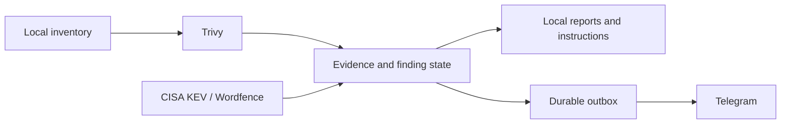

<div align="center">
  
  <h1>Security Monitor</h1>
  <p><strong>Know what needs attention on your Linux server.</strong><br>Read-only vulnerability monitoring. Clear evidence. Telegram alerts. You decide what to change.</p>
  <p>
    <a href="https://github.com/abukreev-dev/sec-monitor/actions/workflows/ci.yml"></a>
    <a href="LICENSE"></a>
    
    
  </p>
  <p><a href="README.ru.md">Русский</a> · <a href="#quick-start">Quick start</a> · <a href="docs/COVERAGE.md">Coverage</a> · <a href="docs/OPERATIONS.md">Operations</a> · <a href="SECURITY.md">Security</a></p>
</div>

---

A self-hosted service around **Trivy**, **CISA KEV** and optional **Wordfence Intelligence**. It records findings, tracks changes and sends grouped alerts instead of forwarding every scanner row to your phone.

**It never patches your server.** No package upgrades, site changes, container replacements, firewall edits or workload restarts. It reports evidence and gives instructions for an administrator to review and carry out manually.

## What it does

| Capability | Behavior |
|---|---|
| OS scanning | DPKG/APT inventory, vendor advisories, origin checks and native version comparisons |
| Fix tracking | Separates vendor-published fixes, repository candidates, detected updates and verified package remediation |
| Known exploitation | Exact CVE correlation with CISA KEV and priority-change events |
| Notifications | Baseline, grouped changes, daily digest, monitoring-health alerts and a durable Telegram outbox |
| WordPress | Static core/plugin/theme/MU metadata and Wordfence ranges; no PHP or plugin hooks executed |
| Dependencies/images | Explicit project paths, immutable image digests or local image archives |
| Local operation | Python standard library, SQLite, systemd oneshot timers; no public listener |



**Pre-release:** Ubuntu 24.04 x86_64 OS scanning has [runtime evidence](docs/ACCEPTANCE_2026-11-06.md). Debian and other releases are experimental until tested. A passing scan is not proof that a host is safe or uncompromised. Read the [coverage matrix](docs/COVERAGE.md).

## Quick start

On the Linux host to monitor: Python 3.10+, APT/DPKG and Internet access for vulnerability databases. No runtime Python packages are required.

```sh
git clone https://github.com/abukreev-dev/sec-monitor.git
cd sec-monitor
./security-monitor discover --output "$HOME/.local/state/sec-monitor/inventory.json"
./security-monitor bootstrap --dry-run
./security-monitor bootstrap
./security-monitor feeds refresh --source kev
./security-monitor scan --target os
./security-monitor report --severity P1,P2
./security-monitor configure
```

`bootstrap` explicitly downloads a pinned, SHA256-checked Trivy release; it never invokes APT. Local reports need no bot token. The wizard stores credentials in a separate 0600 file outside Git. Database downloads require disk space; this is not an offline-from-clone scanner.

## Run periodically

```sh
sudo ./security-monitor --config "$HOME/.config/sec-monitor/config.json" install --dry-run
sudo ./security-monitor --config "$HOME/.config/sec-monitor/config.json" install \
  --secrets-file "$HOME/.config/sec-monitor/secrets.env"
security-monitor doctor
security-monitor scan --target os
security-monitor notifications test
sudo security-monitor service enable
security-monitor service status
```

Omit `--secrets-file` for local-only operation. Installation manages only the monitor's own account, files and units; timers are enabled separately. Workers have no root, sudo or Docker-group access. See [operations](docs/OPERATIONS.md) for configuration, manual upgrades, backup, rollback and removal.

## What a result means

Applicability, fix availability, remediation and monitoring health are independent. A published patch is not necessarily in your repository or installed. A missing CVE is not proof of remediation. Installed packages, running kernels and deployed dependencies are distinct observations.

P1 requires confirmed applicability plus known exploitation. P2 covers confirmed high-risk findings; P3 includes lower-risk and uncertain matches. Full Internet-exposure/RCE inference is not implemented. Custom builds and third-party origins may require manual review.

Trivy is an external pinned engine: no scanner fork is required. An [Ubuntu experiment](docs/SCANNER_EVALUATION_2026-11-06.md) measured compact scanner output at roughly 0.6–0.7 GiB RSS and about 4 seconds warm. These are one-host scanner measurements, not a whole-product minimum-RAM guarantee.

## Privacy

No project SaaS, developer telemetry or shared feed keys. Trivy telemetry is disabled. Whole advisory databases are fetched; the full inventory is not uploaded. Configured image references go to their registries. Telegram receives selected observations and your host alias; keep the chat private.

Project code and PHP hooks are not executed. A stopped host cannot report its own outage; independent heartbeat monitoring is outside the initial release.

## Development and documentation

```sh
python3 -m unittest discover -s tests -v
python3 -m compileall -q src
```

[Coverage](docs/COVERAGE.md) · [Operations](docs/OPERATIONS.md) · [PRD](PRD.md) · [Implementation plan](docs/IMPLEMENTATION_PLAN.md) · [Research](docs/RESEARCH_GITHUB_2026-11-06.md) · [Security](SECURITY.md) · [Contributing](CONTRIBUTING.md) · [Third-party notices](THIRD_PARTY_NOTICES.md)

Apache-2.0 for this project's code. Scanner and advisory data retain their own terms. Tests contain synthetic data; never attach real inventories or tokens to public issues.
