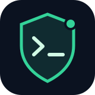

<div align="center">
  
  <h1>Security Monitor</h1>
  <p><strong>Что уязвимо на сервере, что исправлено и что делать дальше.</strong><br>Локальные проверки, история и Telegram. Решение об изменениях принимает администратор.</p>
  <p><a href="README.md">English</a> · <a href="docs/COVERAGE.md">Покрытие</a> · <a href="docs/OPERATIONS.md">Эксплуатация</a></p>
</div>

**Монитор ничего не обновляет:** ОС, пакеты, сайты, зависимости, контейнеры, firewall и работающие службы не изменяются. Он обнаруживает, уведомляет и даёт инструкции для ручного выполнения.

Свой CLI и SQLite поверх Trivy, CISA KEV и необязательного Wordfence Intelligence. Русские отчёты и уведомления, первичная сводка, изменения статусов, очередь доставки и health. Нет веб-панели, публичного порта, PostgreSQL или обязательного SaaS.

## Быстрый запуск

На Linux с Python 3.10+ и APT/DPKG:

```sh
git clone https://github.com/abukreev-dev/sec-monitor.git
cd sec-monitor
./security-monitor discover --output "$HOME/.local/state/sec-monitor/inventory.json"
./security-monitor bootstrap --dry-run
./security-monitor bootstrap
./security-monitor feeds refresh --source kev
./security-monitor scan --target os
./security-monitor report --severity P1,P2
./security-monitor configure
```

`bootstrap` — отдельная явная загрузка закреплённого Trivy с проверкой SHA256. APT и системные пакеты он не трогает. Для локального отчёта Telegram не нужен; ключи вводятся скрыто мастером или через отдельный файл 0600. Не передавайте их в аргументах или Git.

## Установка самого монитора

```sh
sudo ./security-monitor --config "$HOME/.config/sec-monitor/config.json" install --dry-run
sudo ./security-monitor --config "$HOME/.config/sec-monitor/config.json" install \
  --secrets-file "$HOME/.config/sec-monitor/secrets.env"
security-monitor doctor
security-monitor notifications test
sudo security-monitor service enable
```

Без Telegram уберите `--secrets-file`. Установка создаёт только собственные файлы, пользователя и systemd units; таймеры включаются отдельно. Службы работают без root, sudo и Docker-группы. [Обновление монитора, backup/rollback и удаление](docs/OPERATIONS.md).

## Что различается в отчёте

| Измерение | Пример |
|---|---|
| Применимость | Подтверждена / возможна / происхождение пакета неизвестно |
| Исправление | Опубликовано поставщиком / доступно в вашем репозитории / неизвестно |
| Устранение | Открыто / версия изменилась / пакетный фикс проверен / нужна перепроверка |
| Здоровье | Свежая проверка / устаревшие данные / ошибка / область не настроена |

Появление патча, его установка и подтверждение устранения — разные события. Ошибка API и исчезновение CVE не закрывают старые находки. KEV означает известную эксплуатацию в мире, а не взлом данного сервера. Связанные пакеты ядра группируются в сообщениях, индивидуальные связи сохраняются.

## Статус

Проект **pre-release**. OS-скан проверен на Ubuntu 24.04 x86_64; Debian и другие релизы пока экспериментальные. WordPress читает метаданные файлов без PHP/WP-CLI; active/multisite неизвестны. Зависимости и образы проверяются только по заданным областям. Сторонним репозиториям и самосборному ПО может потребоваться ручной источник.

P1 автоматически назначается при подтверждённой применимости и KEV; определение внешней экспозиции/RCE ещё не реализовано. Поддержка целого VPS с 1 GiB RAM требует отдельной проверки. [Покрытие и ограничения](docs/COVERAGE.md) · [Модель угроз](SECURITY.md).

Код — Apache-2.0; источники сохраняют собственные условия и attribution. [Как внести вклад](CONTRIBUTING.md).
